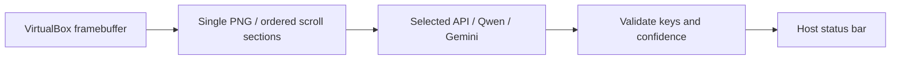

# Contributing

Seth has one inference cycle: capture one question, ask one selected provider,
parse its answer keys, and publish them to the host status bar. Capture is either
one visible screen (Single) or an ordered set of overlapping screens (Scroll).

## Architecture



| Module | Responsibility |
| --- | --- |
| `main.py` | One cycle at a time, manual choices, progress and cancellation |
| `capture.py`, `vbox_backend.py` | Framebuffer/status access and button-free scrolling through an isolated SDK helper |
| `scroll_capture.py` | Bounded top-to-bottom capture, settling and overlap checks; no image stitching |
| `inference.py` | Shared prompt, reply contract, key normalization, provider factory |
| `ai_client.py` | Cancellable HTTP/SSE transport of original image bytes |
| `web_inference.py` | Host provider-chat upload and final-response extraction |
| `cdp.py`, `chromium_runtime.py` | Bounded Chromium control and native profile reuse |
| `browser_service.py` | Independent native provider-tab readiness and lifecycle |
| `hotkey.py`, `trigger.py` | Host shortcuts and private local listener trigger |
| `overlay.py` | Plain-text status and complete wrapped answer keys |
| `cancellation.py` | Per-request cancellation and shutdown observation |
| `settings.py`, `seth_cli.py`, `service_runtime.py` | Configuration and user-service management |

Chromium interactions control provider websites on the host. VM access supports
only `status`, `capture`, and bounded `scroll` events. Scroll uses a fixed right
margin position, zero mouse buttons, a fresh capture, and the same VM/display
identity. Keep answer application, clicks, keyboard input, and arbitrary pointer
operations rejected. Single mode does not access the mouse interface.

Every scroll image retains its original bytes. All images go in one request in
capture order; the prompt tells the provider to combine sections, count overlap
once, and continue numbering across the whole question. Browser adapters verify
all attachment identities, count, order, and readiness before one submission.

## Reply contract

All providers receive the manually selected format and the same prompt contract:

```json
{"status":"answer","confidence":0.95,"answer":"1, 3"}
```

- `answer`: one positive option number for MC; distinct numbers for MCMA;
  comma-separated L/R entries for table rows.
- `confidence`: finite number from 0 to 1. Answers below `min_confidence` become
  `uncertain` with no keys.
- `status`: `answer`, `uncertain`, or `no_action`. Minimal abstentions such as
  `{"status":"uncertain"}` are accepted and normalized to an empty answer.

Unused metadata is ignored. Do not reintroduce a second action/coordinate schema.
The parser checks structure and formatting; the user evaluates the answer.

## Local checks

Install the dependencies from [setup](docs/setup.md). Run the unit suite:

```sh
.venv/bin/python -m unittest discover -s tests -v
```

Run the browser integration fixtures with an installed Chromium/Chrome:

```sh
SETH_CHROMIUM_TESTS=1 .venv/bin/python -m unittest discover -s tests -v
```

Browser fixtures use local fake provider pages and temporary profiles. Tests do
not contact inference accounts, capture the live VM, or use current sign-ins.
The base fake SDK intentionally has no input interface; scroll tests add only a
recording mouse stub or a synthetic whole-page framebuffer. Keep tests for both
capture modes across all providers/formats, exact displayed keys, uncertainty,
cancellation, overlap/limits, complete upload proof, and final-only extraction.

Use `git diff --check` before review. Preserve local credentials, captures, and
profiles; inspect only the data needed for the task. Documentation changes need
no service restart. For runtime changes, restart only the necessary component
and retain provider sessions whenever possible.
